# SOFTWARE REQUIREMENTS SPECIFICATION (SRS)
## for
# EstatePulse: Real Estate Price Prediction & Marketplace Platform
*(Also designated as PropertyPulse in UCS503 Academic Records)*

**Course:** UCS 503 – Software Engineering (Lab Project UCS503P)  
**Academic Institution:** Thapar Institute of Engineering and Technology, Patiala  
**Department:** Computer Science and Engineering Department  
**Class / Group:** 3C14, BE Third Year, Computer Engineering (COE)  
**Document Version:** 1.0  
**Date of Submission:** October 2026  

---

### Project Team Members:
1. **Guntaas Singh** — Roll No: `1024030108`
2. **Haneesh** — Roll No: `1024030112`
3. **Dhruv Rajput** — Roll No: `1024030538`
4. **Atiksh Gupta** — Roll No: `102303133`

**Submitted to:** **Ms. Anushka**, Lecturer / Course Instructor, Computer Science and Engineering Department, TIET

---

## Table of Contents
1. [1. Introduction](#1-introduction)
   - 1.1 [Purpose](#11-purpose)
   - 1.2 [Intended Audience and Reading Suggestions](#12-intended-audience-and-reading-suggestions)
   - 1.3 [Project Scope](#13-project-scope)
   - [Figure 1.1: Entire System Workflow](#figure-11-entire-system-workflow)
2. [2. Overall Description](#2-overall-description)
   - 2.1 [Product Perspective](#21-product-perspective)
   - 2.2 [User Classes and Characteristics (Stakeholders)](#22-user-classes-and-characteristics-stakeholders)
   - [Figure 2.1: User Hierarchy and Stakeholder Classification](#figure-21-user-hierarchy-and-stakeholder-classification)
   - 2.3 [Product Functions and Data Architecture](#23-product-functions-and-data-architecture)
   - [Figure 2.2: Data Flow Diagram (DFD Level-1) and Entity Architecture](#figure-22-data-flow-diagram-dfd-level-1-and-entity-architecture)
   - 2.4 [Operating Environment](#24-operating-environment)
   - 2.5 [Design & System Activities](#25-design--system-activities)
     - [Figure 2.3: Activity Diagram — Buyer Lifecycle](#figure-23-activity-diagram--buyer-lifecycle)
     - [Figure 2.4: Activity Diagram — Seller Lifecycle with ML Validation](#figure-24-activity-diagram--seller-lifecycle-with-ml-validation)
     - [Figure 2.5: Activity Diagram — Evaluation & Measurement System](#figure-25-activity-diagram--evaluation--measurement-system)
     - [Figure 2.6: System UML Use Case Diagram](#figure-26-system-uml-use-case-diagram)
     - [Figure 2.7: UML Class Diagram & Relational Schema](#figure-27-uml-class-diagram--relational-schema)
     - [Figure 2.8: Sequence Diagram — Seller Submission & ML Valuation](#figure-28-sequence-diagram--seller-submission--ml-valuation)
     - [Figure 2.9: Sequence Diagram — Buyer Negotiation & Site Visit Booking](#figure-29-sequence-diagram--buyer-negotiation--site-visit-booking)
3. [3. System Features](#3-system-features)
   - 3.1 [Description and Priority](#31-description-and-priority)
   - 3.2 [Functional Requirements (Module Breakdown)](#32-functional-requirements-module-breakdown)
4. [4. Other Nonfunctional Requirements](#4-other-nonfunctional-requirements)
   - 4.1 [Performance Requirements](#41-performance-requirements)
   - 4.2 [Security & Authentication Requirements](#42-security--authentication-requirements)
   - 4.3 [Software Quality Attributes](#43-software-quality-attributes)
   - 4.4 [Business Rules & Mathematical Specifications](#44-business-rules--mathematical-specifications)
5. [5. Other Requirements and Constraints](#5-other-requirements-and-constraints)
   - 5.1 [Educational & Operational Constraints](#51-educational--operational-constraints)
   - 5.2 [Design and Implementation Constraints](#52-design-and-implementation-constraints)
   - 5.3 [Future System Evolution & Maintenance](#53-future-system-evolution--maintenance)

---

# 1. Introduction

## 1.1 Purpose
In traditional real estate transactions, prospective buyers and property sellers suffer from severe information asymmetry, fragmented communication across unlinked messaging applications, opaque pricing mechanisms, and spam or duplicate listings. 

The purpose of this **Software Requirements Specification (SRS)** is to provide a complete, rigorous, and verifiable definition of **EstatePulse** (academically cataloged as *PropertyPulse*). EstatePulse is a full-stack, AI-driven real estate marketplace and valuation system developed for the **UCS503 Software Engineering** curriculum at Thapar Institute of Engineering and Technology. 

This document defines the functional capabilities, non-functional performance guarantees, architectural models, UML diagrams, mathematical frameworks, and operational constraints governing the implementation and deployment of EstatePulse Version 1.0.

## 1.2 Intended Audience and Reading Suggestions
This SRS document is authored for the following stakeholders:
- **Academic Evaluators and Course Instructors (Ms. Anushka):** To review and verify that the system fulfills all pedagogical and technical requirements outlined in the approved project proposal and mid-semester milestones.
- **Development Team (Guntaas Singh, Haneesh, Dhruv Rajput, Atiksh Gupta):** To serve as the definitive technical blueprint during software construction, API design, ML model integration, and frontend implementation.
- **Quality Assurance & Verification Testers:** To design unit tests, automated CI/CD pipeline assertions, and system integration verification tests.
- **Prospective Users (Buyers, Sellers, Platform Operators):** To understand the functional boundaries, workflows, and operational capabilities of the software.

*Reading Suggestions:*
- Sections 1 and 2 present high-level concepts, scope, stakeholder hierarchies, and system activity workflows.
- Section 3 details the functional requirements and API contracts.
- Section 4 provides mathematical derivations, non-functional requirements, and business logic.
- Section 5 outlines architectural constraints and roadmap evolutions.

## 1.3 Project Scope
EstatePulse creates an end-to-end, unified digital ecosystem bridging buyers and property sellers with embedded Machine Learning pricing intelligence:
1. **Property Listing & Instant Valuation:** Sellers can catalog real estate across diverse categories (*Residential, Apartment, Villa, Commercial, Entertainment*). Upon input of physical dimensions, age, and amenities, an integrated Multiple Linear Regression service immediately predicts the fair market price and flags duplicate listings.
2. **Buyer Discovery & Visual Barometer:** Buyers can search, filter, and review active listings. The *Buyer Barometer* visual indicator categorizes properties (*Great Deal, Fair Market Price, Premium*) based on mathematical variance between asking prices and regression predictions.
3. **Integrated Negotiation & Communication:** Instead of relying on disconnected third-party channels, a dedicated WhatsApp-style conversational thread is instantiated per property, allowing direct buyer-seller message exchange.
4. **Site Visit Scheduling & Escrow Token Payment:** Buyers can formalize physical inspections by booking appointment slots and committing nominal visit tokens through an integrated payment workflow.
5. **Measurable Metric Attribution:** The platform instruments and reports empirical software engineering metrics, notably **Time-to-Appointment** ($T_{appt} = t_{confirmed} - t_{first\_inquiry}$), ML accuracy ($R^2$, $MSE$, $MAE$), and buyer engagement rates.

### Figure 1.1: Entire System Workflow
The overall interaction cycle connecting Buyers, Sellers, the Machine Learning Engine, and Platform Evaluation is illustrated below:

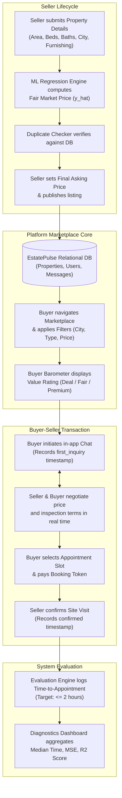

---

# 2. Overall Description

## 2.1 Product Perspective
EstatePulse is an independent, self-contained, 3-tier web platform engineered to replace fragmented, unverified property ad postings. The system context incorporates:
- **Presentation Layer:** A responsive Single-Page Application (SPA) built using HTML5, CSS3, and modern Vanilla ES6 JavaScript, optimized for both desktop viewports and touch-oriented mobile devices.
- **Application & ML Layer:** A lightweight REST API service authored in Python utilizing the Flask web framework, hosting an integrated Scikit-Learn predictive inference engine and duplicate text-matching algorithms.
- **Data Persistence Layer:** A transactional SQLite relational database storing normalized tables for user accounts, listings, chat logs, appointment schedules, and payment audit logs.

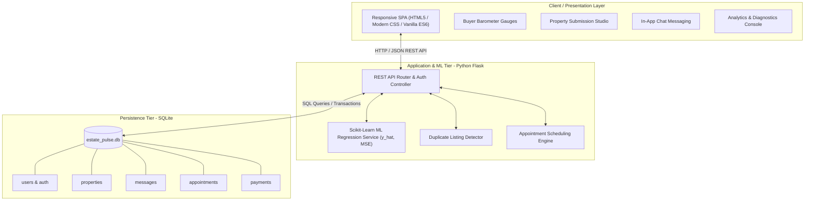

## 2.2 User Classes and Characteristics (Stakeholders)
The system categorizes users into three distinct functional classes with tailored privileges:

1. **General User / Guest:**
   - Unauthenticated visitors browsing the platform.
   - Privileges: Browse active listings, search by city and category, inspect public property details, view Buyer Barometer scores. Cannot initiate chat, submit listings, or schedule visits without authenticating.
2. **Buyer:**
   - Authenticated individuals looking to inspect and acquire real estate.
   - Characteristics: Value-conscious, looking for market transparency and rapid scheduling.
   - Privileges: Filter by Buyer Barometer rating, save favorite properties, negotiate directly with sellers via property chat, book site visit appointments, pay booking verification fees.
3. **Seller:**
   - Authenticated property owners or real estate agents.
   - Characteristics: Seeking prompt pricing validation, quick turnaround on site visits, and spam-free inquiries.
   - Privileges: Access the Property Listing Studio, obtain real-time ML price estimates prior to submission, manage listed properties, chat with inquiring buyers, and confirm appointment requests.
4. **Platform Administrator / Evaluator:**
   - Course instructors and system maintainers overseeing platform health and academic metrics.
   - Privileges: Access the System Diagnostics Dashboard, track regression model performance ($R^2$, $MSE$, $MAE$), monitor active transaction timestamps, and inspect time-to-appointment histograms.

### Figure 2.1: User Hierarchy and Stakeholder Classification
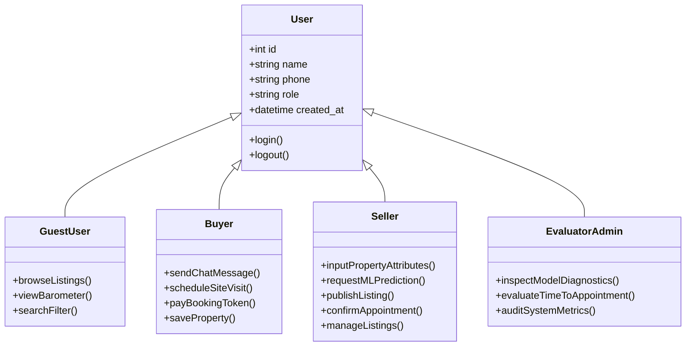

## 2.3 Product Functions and Data Architecture
The system coordinates data across five primary entities: `User`, `Property`, `Message`, `Appointment`, and `Payment`.

### Figure 2.2: Data Flow Diagram (DFD Level-1) and Entity Architecture
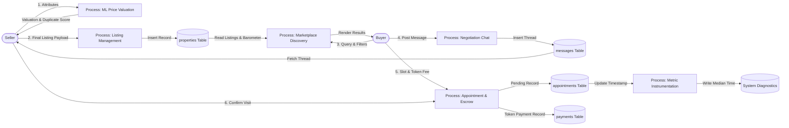

## 2.4 Operating Environment
EstatePulse operates across standard, cost-effective computing environments:
- **Server Operating System:** Cross-platform (Windows 10/11, Ubuntu Linux 20.04+, macOS).
- **Backend Runtime:** Python 3.10+ (Flask 3.x, Werkzeug, Scikit-learn 1.4+, NumPy, Joblib).
- **Database System:** SQLite 3 (embedded zero-configuration relational database).
- **Client Web Browsers:** Google Chrome 110+, Mozilla Firefox 115+, Apple Safari 16+, Microsoft Edge, Android Chrome, and iOS Safari.
- **Hardware Footprint:**
  - Server: Minimum 1 vCPU, 512 MB RAM (lightweight memory footprint < 120 MB during active ML inference).
  - Client: Low-to-mid range mobile smartphones or standard personal computers.

## 2.5 Design & System Activities

### Figure 2.3: Activity Diagram — Buyer Lifecycle
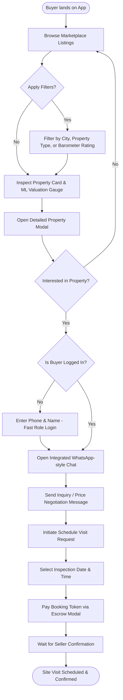

### Figure 2.4: Activity Diagram — Seller Lifecycle with ML Validation
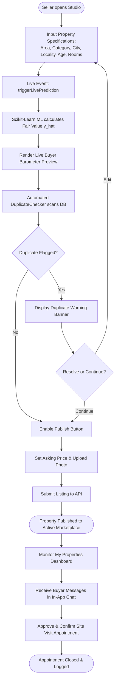

### Figure 2.5: Activity Diagram — Evaluation & Measurement System
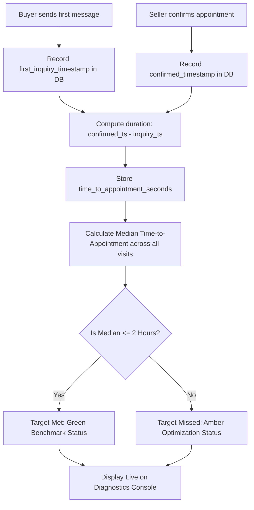

### Figure 2.6: System UML Use Case Diagram
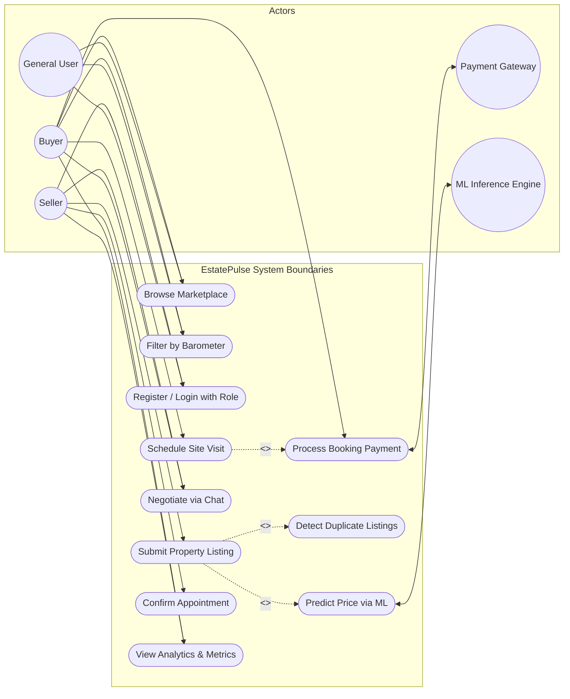

### Figure 2.7: UML Class Diagram & Relational Schema
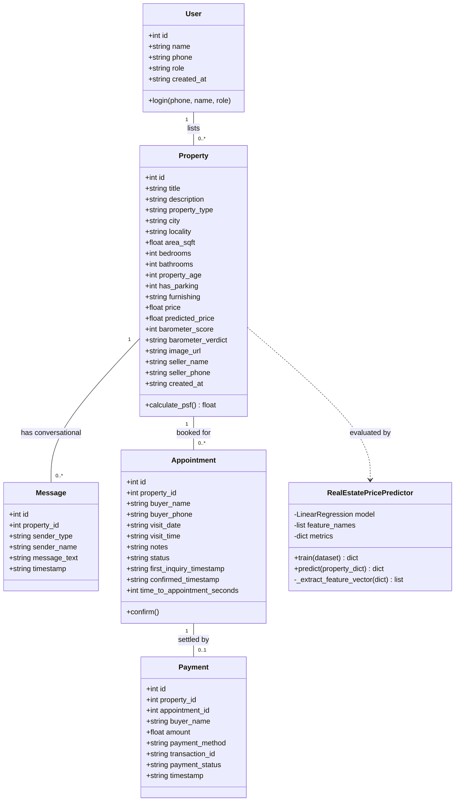

### Figure 2.8: Sequence Diagram — Seller Submission & ML Valuation
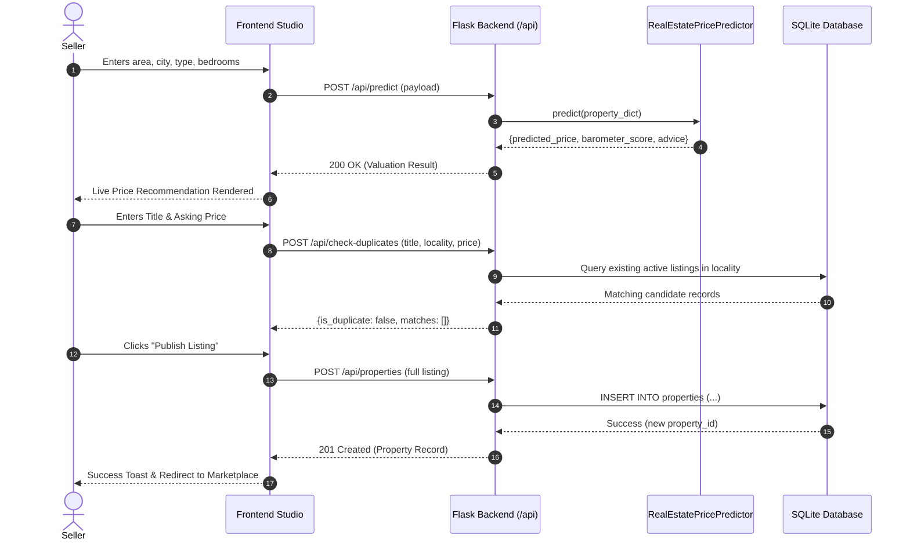

### Figure 2.9: Sequence Diagram — Buyer Negotiation & Site Visit Booking
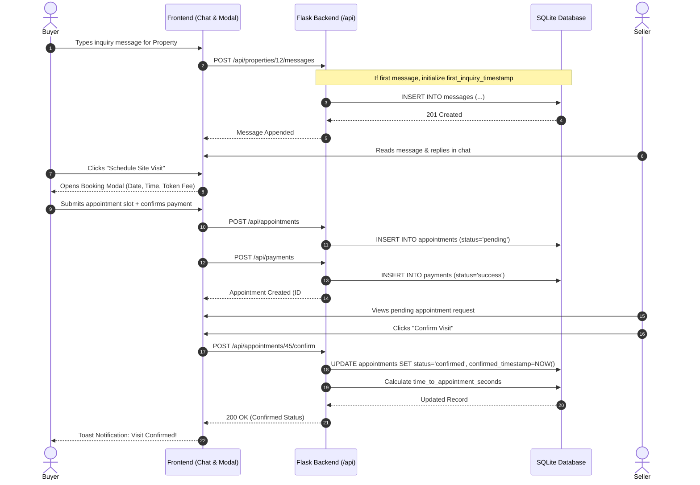

---

# 3. System Features

## 3.1 Description and Priority
The system features are classified into prioritized engineering components based on the iterative delivery model outlined in the approved project proposal:

| Priority | Feature ID | Feature Name | Core Purpose | Status |
| :--- | :--- | :--- | :--- | :--- |
| **High (P1)** | `FEAT-01` | **ML Price Predictor Engine** | Calculates fair market valuation using Multiple Linear Regression based on structural features. | Implemented |
| **High (P1)** | `FEAT-02` | **Property Listing & Duplicate Check** | Allows sellers to list real estate and flags candidate duplicate listings before saving. | Implemented |
| **High (P1)** | `FEAT-03` | **Buyer Barometer Visualizer** | Categorizes listings (*Great Deal, Fair Value, Premium*) based on deviation between asking and model price. | Implemented |
| **High (P1)** | `FEAT-04` | **In-App Negotiation Chat** | Facilitates contextual buyer-seller direct messaging per property thread. | Implemented |
| **Medium (P2)**| `FEAT-05` | **Site Visit Scheduling & Payment** | Enables visit scheduling and collects booking token fees via payment gateway simulation. | Implemented |
| **Medium (P2)**| `FEAT-06` | **Role-Based Auth & Guest Access** | Seamless phone login segmenting Buyer and Seller dashboards while preserving Guest browsing. | Implemented |
| **Low (P3)** | `FEAT-07` | **Diagnostics & Metric Attribution** | Empirical dashboard tracking Time-to-Appointment, MSE, and engagement metrics. | Implemented |

---

## 3.2 Functional Requirements (Module Breakdown)

### 3.2.1 Module 1: Property Listing & Duplicate Detection (`FEAT-02`)
- **FR-1.1 Input Attributes:** The system shall accept property listings with attributes: Title, Description, Category (*Residential, Commercial, Apartment, Villa, Entertainment*), City, Locality, Area (sq.ft), Bedrooms, Bathrooms, Age (years), Parking (Yes/No), Furnishing status (*Unfurnished, Semi-Furnished, Fully-Furnished*), and Asking Price (INR).
- **FR-1.2 Validation:** The system shall enforce mandatory field validations. Area must be greater than 0; price must be positive.
- **FR-1.3 Duplicate Detection:** Upon entry of title and locality, the system shall execute `POST /api/check-duplicates` against the database. If a listing with matching locality, similar area ($\pm 5\%$), and category exists, the system shall alert the seller with a visual warning prompt.
- **FR-1.4 Data Persistence:** Successfully submitted listings shall be inserted into the `properties` table and immediately indexed for marketplace retrieval.

### 3.2.2 Module 2: Machine Learning Price Predictor (`FEAT-01`)
- **FR-2.1 Real-Time Prediction:** As the seller modifies property attributes, the frontend shall invoke `POST /api/predict` (debounced at 300ms) to compute an instant estimated price.
- **FR-2.2 Feature Vectorization:** The ML engine shall convert qualitative attributes (Category, City, Furnishing) into one-hot encoded vectors, combining them with normalized continuous values.
- **FR-2.3 Model Return Values:** The prediction response shall return: `predicted_price`, `barometer_score` (0–100), `barometer_verdict`, and `advice`.

### 3.2.3 Module 3: Buyer Barometer Visual Guidance (`FEAT-03`)
- **FR-3.1 Variance Computation:** The system shall calculate the percentage difference between the seller's asking price ($P_{ask}$) and the model's predicted price ($P_{pred}$):
  $$\Delta\% = \left(\frac{P_{ask} - P_{pred}}{P_{pred}}\right) \times 100$$
- **FR-3.2 Classification:**
  - $\Delta\% \le -10\%$: Categorized as **"Great Deal"** (displayed with emerald green badge).
  - $-10\% < \Delta\% \le +10\%$: Categorized as **"Fair Market Price"** (displayed with blue badge).
  - $\Delta\% > +10\%$: Categorized as **"Premium / High"** (displayed with amber/red badge and negotiation recommendation).
- **FR-3.3 Filterability:** Buyers shall be capable of filtering listings exclusively by Buyer Barometer verdicts.

### 3.2.4 Module 4: Integrated WhatsApp-Style Chat (`FEAT-04`)
- **FR-4.1 Contextual Channel per Property:** Each property shall maintain an isolated messaging thread identified by `property_id`.
- **FR-4.2 Message Delivery:** The system shall support sending and retrieving messages through `POST /api/properties/<id>/messages` and `GET /api/properties/<id>/messages`.
- **FR-4.3 Polling Synchronization:** The active chat thread shall poll the server at 3000ms intervals to reflect incoming responses without full-page reloads.
- **FR-4.4 First Inquiry Timestamping:** The receipt of the first message on a property from a prospective buyer shall instantiate the `first_inquiry_timestamp` for appointment SLA tracking.

### 3.2.5 Module 5: Site Visit Scheduling & Payment Token (`FEAT-05`)
- **FR-5.1 Slot Booking:** Buyers shall select an inspection date (minimum next calendar day) and specific time slot.
- **FR-5.2 Escrow Token Processing:** Submission of an appointment shall require recording a token fee through `POST /api/payments` with attributes: `amount`, `payment_method` (UPI, Card, Net Banking), and auto-generated `transaction_id`.
- **FR-5.3 Status Lifecycle:** The appointment status shall initialize as `pending` until the seller invokes `POST /api/appointments/<id>/confirm`, changing status to `confirmed`.
- **FR-5.4 Duration Computation:** Upon seller confirmation, the system shall compute:
  $$\text{time\_to\_appointment\_seconds} = t_{confirmed} - t_{first\_inquiry}$$

### 3.2.6 Module 6: System Diagnostics & Metrics (`FEAT-07`)
- **FR-6.1 Primary Evaluation Metric:** The system shall expose `GET /api/metrics`, aggregating the median time-to-appointment across all closed records.
- **FR-6.2 Model Quality Metrics:** The dashboard shall display model accuracy metrics: Mean Squared Error ($MSE$), Root Mean Squared Error ($RMSE$), Mean Absolute Error ($MAE$), and Coefficient of Determination ($R^2$).
- **FR-6.3 Marketplace KPI Display:** Active listings count, total inquiries, confirmed visits, and chat engagement ratios shall be reported in real time.

---

# 4. Other Nonfunctional Requirements

## 4.1 Performance Requirements
- **NFR-1.1 ML Inference Latency:** The regression prediction endpoint (`POST /api/predict`) shall execute inference and respond within **< 100 milliseconds** under standard workload.
- **NFR-1.2 Page Load Time:** The single-page web client shall achieve an initial DOM interactive state in **< 1.5 seconds** over standard broadband or 4G mobile connections.
- **NFR-1.3 Database Query Latency:** Relational queries filtering properties by city, type, and price range shall return in **< 50 milliseconds**.
- **NFR-1.4 Time-to-Appointment SLA:** As defined in the approved project proposal, the platform target is to maintain a **median Time-to-Appointment $\le 2$ hours** during operational pilot runs.

## 4.2 Security & Authentication Requirements
- **NFR-2.1 SQL Injection Prevention:** All persistence interactions must utilize parameterized SQL queries through Python SQLite cursors; string concatenation for SQL execution is strictly forbidden.
- **NFR-2.2 Cross-Site Scripting (XSS) Sanitization:** All user-generated text inputs (property descriptions, chat messages, notes) must be HTML-escaped prior to DOM injection.
- **NFR-2.3 Role Isolation:** State-changing operations must validate user identity. Sellers may only modify or delete properties registered under their verified phone credentials.
- **NFR-2.4 Privacy & Sensitive Data:** Phone numbers and payment tokens must be transmitted securely over HTTP/HTTPS headers, without exposing financial card credentials.

## 4.3 Software Quality Attributes
- **NFR-3.1 Usability & Responsive Layout:** The interface must implement responsive CSS media queries adapting fluidly between mobile screens ($\le 480\text{px}$), tablets ($\le 768\text{px}$), and desktop viewports ($\ge 1024\text{px}$). Touch targets shall maintain a minimum dimension of $44 \times 44\text{px}$.
- **NFR-3.2 High-Contrast Clarity:** Text labels, inputs, and badges must maintain a minimum contrast ratio of 4.5:1 against card backgrounds to ensure readability without visual strain.
- **NFR-3.3 Reliability & Availability:** The platform shall guarantee $\ge 99\%$ uptime during designated course evaluation periods. Transient client network errors must trigger graceful toast notifications rather than application crashes.
- **NFR-3.4 Maintainability & Modularity:** The backend codebase shall maintain complete decoupling between the database layer (`database.py`), the Machine Learning pipeline (`ml_model.py`), and the HTTP API routing controller (`app.py`).

## 4.4 Business Rules & Mathematical Specifications

### 4.4.1 Machine Learning Valuation Formulation
The baseline pricing engine implements Multiple Linear Regression with L2 regularization considerations:
$$\hat{y} = \beta_0 + \sum_{i=1}^{n} \beta_i x_i + \epsilon$$

Where:
- $\hat{y}$ = Predicted fair market price (INR).
- $\beta_0$ = Base intercept.
- $x_1, \dots, x_n$ = Vector of continuous features (Area, Age, Rooms, Baths) and one-hot encoded binary variables (City, Category, Furnishing, Parking).
- $\epsilon$ = Residual error term.

Model performance is evaluated against closing market prices using Mean Squared Error ($MSE$) and Coefficient of Determination ($R^2$):
$$MSE = \frac{1}{n} \sum_{i=1}^{n} (y_i - \hat{y}_i)^2$$
$$R^2 = 1 - \frac{\sum_{i=1}^n (y_i - \hat{y}_i)^2}{\sum_{i=1}^n (y_i - \bar{y})^2}$$

### 4.4.2 Appointment State Lifecycle Rules
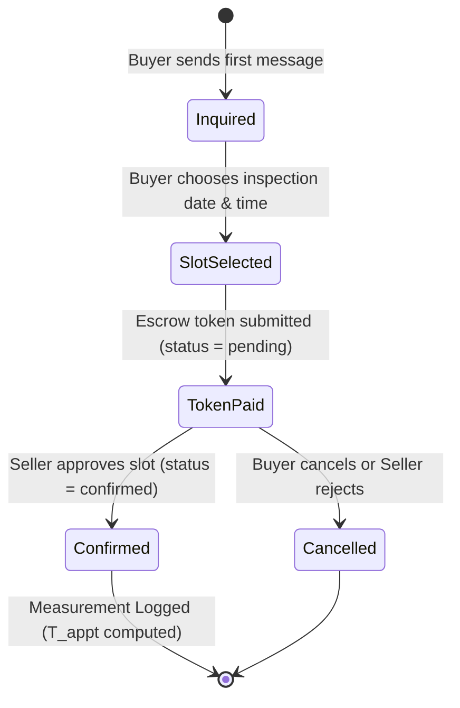

---

# 5. Other Requirements and Constraints

## 5.1 Educational & Operational Constraints
- **Cost Minimization:** The software must run without external commercial subscription dependencies. Machine learning models must execute locally via Scikit-Learn without requiring paid external LLM or cloud API tokens.
- **Resource Constraints:** Memory usage of the deployed server must remain under 512 MB to allow execution on standard academic laboratory workstations or shared student hostings.
- **Time-to-Value Delivery:** Engineering increments must adhere to iterative sprint cycles, prioritizing functional user flows over non-essential deep-learning complexity.

## 5.2 Design and Implementation Constraints
- **Backend Stack:** Python 3.10+, Flask REST API.
- **Frontend Stack:** Vanilla HTML5, CSS3 (Modern Flexbox & CSS Grid), ES6+ JavaScript. No heavyweight build tools (Webpack, Vite) required, enabling immediate execution by opening the Flask server.
- **Persistence:** SQLite 3 storing data locally in `real_estate.db`.
- **Packaging:** Git-versioned repository with standardized documentation, markdown journals, and automated test suites (`tests/test_api.py`).

## 5.3 Future System Evolution & Maintenance
1. **Full WebSocket Integration:** Transitioning chat polling from HTTP setInterval (3000ms) to bi-directional WebSocket connections (e.g., Flask-SocketIO) for zero-latency notification delivery.
2. **Computer Vision Image Deduplication:** Integrating Perceptual Hashing (pHash) or convolutional neural network embeddings to identify duplicate property submissions sharing identical exterior photography.
3. **Automated Production CI/CD Deployment:** Extending GitHub Actions workflow to auto-deploy production containers to PaaS environments (e.g., Render, Railway, or AWS Lightsail) upon branch merges.

---

### Verification and Approval Sign-Off

| Role | Name | Roll Number | Signature / Status |
| :--- | :--- | :--- | :--- |
| **Team Member 1** | Guntaas Singh | 1024030108 | Completed |
| **Team Member 2** | Haneesh | 1024030112 | Completed |
| **Team Member 3** | Dhruv Rajput | 1024030538 | Completed |
| **Team Member 4** | Atiksh Gupta | 102303133 | Completed |
| **Course Instructor** | Ms. Anushka | Faculty, TIET | Pending Lab Review |
